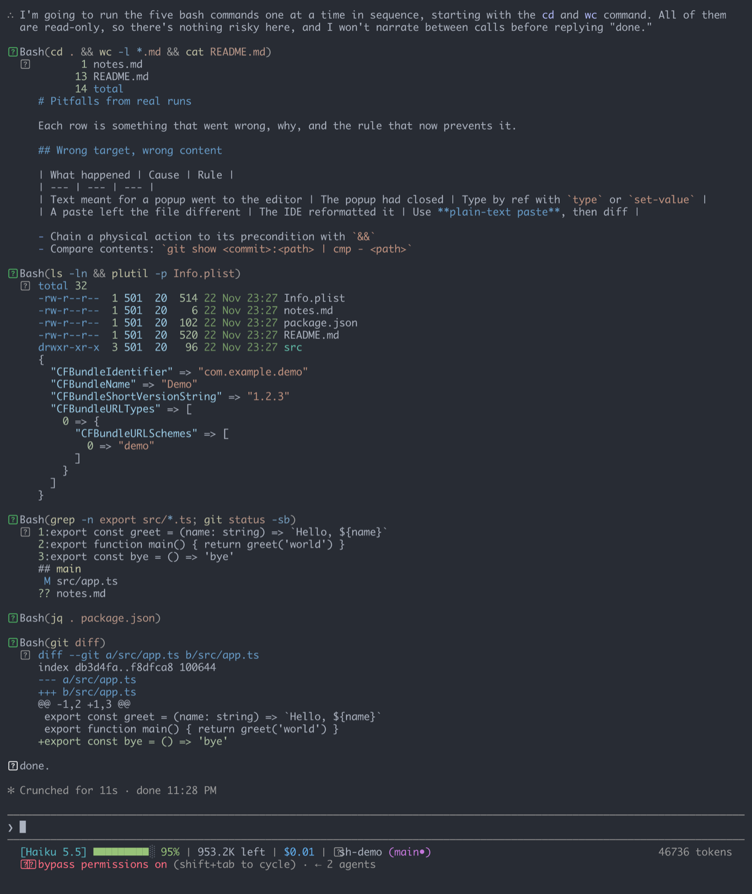

# syntax-highlight

A Claude Code mod that syntax-highlights the commands Claude runs **and what they print**, using your editor's colour theme and TextMate grammars. Markdown files, JSON, diffs, `ls -l` listings, `grep -n` hits and `plutil -p` dumps come out coloured instead of plain grey-on-black.



It is a fork of [syntax-cmd](https://github.com/Lucasbk38/claude-syntax-cmd) by Lucasbk38, which colours the commands; this fork adds the output. Everything syntax-cmd does is kept.

## Install

At the prompt of a Claude Code terminal session:

```text
/plugin install syntax-highlight --marketplace laststance/claude-plugins
```

From a shell:

```sh
claude plugin install syntax-highlight --marketplace laststance/claude-plugins
```

Requires `node` on the PATH and Claude Code 2.1.287 or later (tested with 2.1.330).

**Coming from syntax-cmd?** Uninstall it (`claude plugin uninstall syntax-cmd@claude-syntax-cmd`): both mods redraw the same rows. Your edited `~/.claude/syntax-cmd/runners.json` is not read any more; copy it to `~/.claude/syntax-highlight/runners.json`.

## What gets coloured

**Commands** (the `Bash(...)` row), as syntax-cmd does: the shell, kept dim, and code inside it in its own language (`node -e`, `python -c`, heredocs, `cat > file.py <<EOF`). Claude can also show you a snippet in full colour with the `show_code` tool.

**Output** (the block under the row, after `⎿`). Characters are never changed, only coloured. How a block is read:

- **A Language for the whole block**, from the command that printed it:
  - `cat`, `head`, `tail`, `bat` or `sed -n` of files: the files' language, from their extension.
  - `jq`, `yq`, `gh api`: JSON or YAML.
  - `git diff`, `git show`, `git log -p`, `diff -u`: a diff.
  - A block of valid JSON from any other command, such as `curl`: JSON.

  `cd`, `mkdir` and the like are skipped, so `cd docs && cat a.md` is Markdown. A pipeline is read through its filters, so `cat a.ts | head -40` is TypeScript.
- **Output shapes, line by line**, turned on by the programs in the command:

  | Command | Lines it colours |
  | --- | --- |
  | `ls -l` | mode, size, date, name (folders, links, executables); `total`; `folder:` headers |
  | `grep -n`, `rg` | `path:line:` and `line:` hits, `path-line-` context, `--` |
  | `plutil -p` | `"key" => value` pairs and `0 => value` items |
  | `git status` | `--short` status letters, `## branch...upstream`, `modified:` rows |
  | `wc` | counts and `total` |

  Inside a Language block only rows nothing else prints keep their shape: an `ls -l` row, a `path:12:` hit, a `wc` row (counts padded to 8 columns, or before a name with a `.` or `/`, or `total`), a `git status --short` row of status letters and one path, `## branch...upstream`. So `wc -l *.md && cat README.md` colours both, while a heading (`## Usage`), a time (`09:30`), an indented number (`  3 items`), a line opening with status-like capitals (`MR 12 is merged`) or a frontmatter key ending in `:` stays in the Language.

A block is drawn as Claude Code draws it, coloured or not: the same indent, and when collapsed the same fold (`… +N lines (ctrl+o to expand)`). Blocks with stderr, errors, interrupts, images or background tasks are left to Claude Code. Past 2,000 lines or 200 KB, the rest of a block is drawn without colour.

Claude Code itself hides the output of some lone file reads (a bare `cat file.md` or `jq . file.json`), so there is nothing to colour there.

## Configure

In Claude Code: `/config`, then the `syntax-highlight` rows.

| Option | Default | Meaning |
| --- | --- | --- |
| `editor` | `auto` | whose theme and grammars to use (VS Code, Cursor, Windsurf, VSCodium, Zed, Sublime Text, JetBrains, Neovim, Helix, Vim) |
| `theme` | empty | theme name override (e.g. `One Dark Pro`) |
| `strength` | `0.55` | colour strength of Bash commands (0 grey, 1 full) |
| `outputStrength` | `0.75` | same for what a command prints; uncoloured text stays as it is |
| `codeStrength` | `1` | same for `show_code` output |
| `collapsedLines` | `3` | lines of a long command shown before "ctrl+o to expand" |

`editor: auto` picks the IDE Claude Code is connected to, else `$VISUAL`/`$EDITOR`, else the first editor found.

## Runners (code inside commands)

Which programs carry code, and in what language, lives in [`runners.json`](runners.json). It is copied to `~/.claude/syntax-highlight/runners.json` on first use (or the file named by `$SYNTAX_HIGHLIGHT_RUNNERS`), and that copy is what gets loaded. Edit it to add languages:

```json
{ "program": "^lua(jit)?$", "language": "lua", "evalFlags": ["-e"] }
```

`language` is a TextMate scope (`source.lua`) or a short id (`lua`, `py`, `js`). `evalFlags` are flags whose next word is code (`evalPattern` takes a regex instead), `skipFlags` swallow one argument, `stopFlags` end the scan (like `-m`), `words` are subcommands to skip, `after` is a subcommand that precedes the code (`deno eval`).

## Tests

From the repository root:

```sh
claude plugin test plugins/syntax-highlight
node --test plugins/syntax-highlight/tests/tokenize.test.mjs
```

The first runs the planning and rendering tests in Claude Code's mod test kit; the second runs the colouring worker (`tokenize.mjs`), a Node program the kit cannot start.

## Credits and licenses

Forked from [Lucasbk38/claude-syntax-cmd](https://github.com/Lucasbk38/claude-syntax-cmd) at `a791d1d` (v0.2.3), MIT. Why a fork and not a companion mod: [docs/adr/0001](docs/adr/0001-fork-syntax-cmd-and-draw-output-blocks.md).

Bundled TextMate grammars and themes come from [tm-grammars and tm-themes](https://github.com/shikijs/textmate-grammars-themes) (MIT); `vscode-textmate` and `vscode-oniguruma` are vendored (MIT). See `bundled/` and `vendor/` for their licenses.

[MIT](LICENSE)
